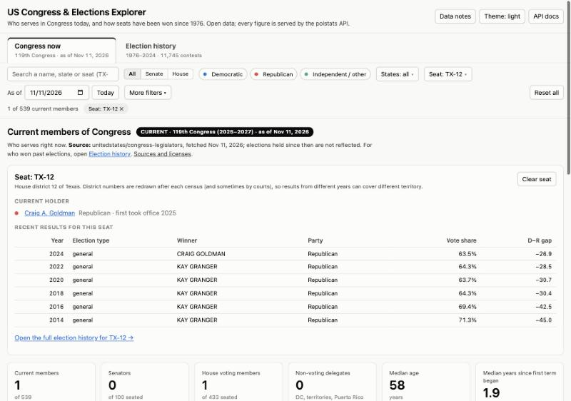
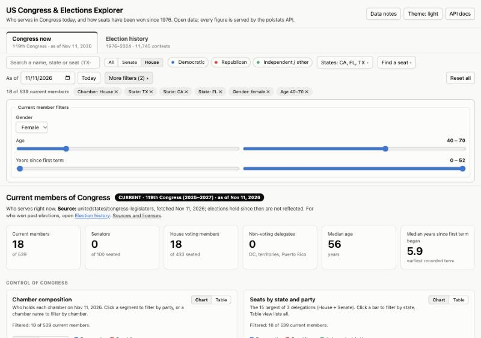

# polstats

[](https://github.com/charlestirrell/polstats/actions/workflows/ci.yml)

**An open-source data store, REST API and explorer for US national politics**: who sits in Congress, from which
state and district, in which party and when, and how they got there. Built on Python, PostgreSQL and public data.

polstats turns scattered public sources (member rosters, election returns) into one consistent, versioned,
time-aware dataset with stable cross-reference IDs, a searchable REST API, and a verification UI that doubles as a
data-quality dashboard. **The repository contains no data**: every dataset is pulled from its original publisher by
a reproducible, checksum-verified command.


## Status

Early alpha (v0.1). It works end to end for the current Congress and for Senate and House election history; the API
is not yet stable and there is no authentication, so run it locally.

| Works today | Not yet |
|---|---|
| Current members of Congress: terms, party history, cross-reference IDs | 2025–26 special elections and 2026 results (not yet published by the source) |
| Senate and House election results 1976–2024 (11,745 contests, 36,000 candidates) | Historical members (so past dates show only today's members) |
| REST API with search, paging, `_include`, versioning | Bills, votes, committees, campaign finance |
| Explorer UI: current Congress and election history, seat lookup, live filters | Authentication, deletes, a hosted instance |
| Reproducible, checksum-verified data fetching | |

## Features

- **Time-aware by design**: every term and party affiliation carries a period, so "who held this seat on 2020-01-01"
  is a query, not a snapshot.
- **Cross-reference IDs** (Bioguide, FEC, ICPSR, GovTrack, OpenSecrets, Wikidata, ...) on every person, so other
  datasets can be joined in.
- **Provenance on everything**: each record says which source and which version of the file asserted it.
- **Derived values are labelled**: the election sources have no winner column, so winners are computed and flagged
  `outcomeDerived`, never passed off as source data.
- **Versioned records**: every update creates a new version; `GET /Person/{id}/_history` shows them all.
- **Idempotent, fail-loud loaders**: re-running a load changes nothing unless the source changed, and a key
  collision raises an error instead of silently overwriting data.
- **Live filtering across everything**: one filter bar (search, chamber, party, states, age, years in Congress,
  election years and kinds, vote margin, contested or not, ...) updates every chart, table and count instantly, and
  filters live in the URL so any view can be shared.
- **Current Congress and election history, kept apart**: two views with their own filters, sources and coverage statements,
  joined by seat and by person. Analysts can type a district code (TX-12) and see who holds it and how it was won.
- **Honest about gaps**: held-over seats, vacancies, uncontested races, and what the data does not cover are shown on the
  page, and a collapsed notes section lists sources and automated checks (seat counts, duplicate seats, vote totals).

## Quick start

**Prerequisites:** Python 3.12+, [uv](https://docs.astral.sh/uv/), and Docker with Compose (on macOS, Docker Desktop
or [Colima](https://github.com/abiosoft/colima)).

```bash
git clone https://github.com/charlestirrell/polstats.git && cd polstats
docker compose up -d --wait        # PostgreSQL 17, bound to 127.0.0.1:5432 (public development password)
uv sync                            # install dependencies
export PYTHONPATH=src              # PowerShell: $env:PYTHONPATH = "src"

# 1. fetch raw data into raw/ (git-ignored), verifying checksums
uv run python -P -m polstats.fetch medsl-senate congress-legislators
#    optional: House results; needs a Dataverse form, see "Data sources" below
# uv run python -P -m polstats.fetch medsl-house

# 2. load it (members first, so election winners can be linked to people)
uv run python -P -m polstats.loaders.congress_legislators raw/congress-legislators/legislators-current.json
uv run python -P -m polstats.loaders.medsl raw/medsl-senate/1976-2024-senate-state.csv
# uv run python -P -m polstats.loaders.medsl raw/medsl-house/1976-2024-house.csv   # ~2 minutes

# 3. run the API + explorer
uv run uvicorn polstats.api.app:app --port 8000
```

Open <http://localhost:8000/ui/> for the explorer and <http://localhost:8000/docs> for the interactive API docs.

Run the tests with `uv run pytest`. Tests that need a database use a separate `polstats_test` database and skip
themselves if Postgres isn't running.

## Data sources

| Source | Provides | License | Fetched as |
|---|---|---|---|
| [unitedstates/congress-legislators](https://github.com/unitedstates/congress-legislators) | Members of Congress, terms, party, IDs | CC0 1.0 (the project's LICENSE file) | `congress-legislators` (mutable: re-fetch with `--refresh`) |
| [MIT Election Data + Science Lab: U.S. Senate 1976–2024](https://doi.org/10.7910/DVN/PEJ5QU) | Statewide Senate returns | CC0 1.0 (per Dataverse) | `medsl-senate` |
| [MIT Election Data + Science Lab: U.S. House 1976–2024](https://doi.org/10.7910/DVN/IG0UN2) | House district returns | CC0 1.0 (per Dataverse) | `medsl-house` (needs a Dataverse form, see below) |

[`sources.toml`](sources.toml) is the manifest: what to fetch, pinned Dataverse file IDs, and the MD5 that
Dataverse publishes for each original upload. `polstats.fetch` downloads into `raw/<source>/`, verifies every
checksum, and skips files that already verify. A test (`tests/test_repo_hygiene.py`) fails if raw data or personal
config could ever be committed.

```bash
uv run python -P -m polstats.fetch --list
uv run python -P -m polstats.fetch --refresh congress-legislators
```

**The MEDSL House file** is served by Harvard Dataverse only after a "guestbook" response (name, email,
affiliation). Copy `config/dataverse.example.toml` to `config/dataverse.local.toml` (git-ignored), fill it in, and run
`polstats.fetch medsl-house`. Your details are read only when the server asks for them, are sent only to
`dataverse.harvard.edu`, and are never printed or logged. (A plain `polstats.fetch` reports the House files as
failed until this is configured.)

**Licensing note:** polstats' MIT license covers this *code*. The datasets are not included and remain under their
publishers' terms; you are responsible for complying with them. Please cite the datasets you use (see the DOIs above).

## Data model

Ten resource types, stored as versioned JSON documents. Full detail in [docs/DESIGN.md](docs/DESIGN.md).

| Resource | What it represents |
|---|---|
| `Person` | A human: names, birth date, gender, cross-reference identifiers |
| `OfficeTerm` | A person holding a seat for a period: office, chamber, state, district or Senate class |
| `PartyAffiliation` | A person's party over a period (separate from terms: people switch parties mid-term) |
| `Organization` | Parties (committees and caucuses are planned) |
| `Location` | Nation → state → district hierarchy |
| `Election` | A cycle and kind of election (general, special, runoff, primary) |
| `Contest` | One race: office + state (+ district) within an election |
| `Candidacy` | A candidate in a contest, linked to a `Person` when it can be done unambiguously |
| `ContestResult` | Votes, vote share and (derived) outcome for one candidacy |
| `Provenance` | Which source, version and license asserted a set of records |

## API

Search with typed parameters; unknown parameters are rejected with a 400 rather than silently ignored.

```text
GET /Provenance?source=MIT%20Election%20Data%20and%20Science%20Lab&_count=1    # where the data came from
GET /OfficeTerm?state=TX&chamber=senate&active-on=2026-11-10&_include=OfficeTerm:person
GET /OfficeTerm?state=TX&chamber=house&party=R&active-on=2026-11-10
GET /Person?identifier=https://bioguide.congress.gov|C000127
GET /Person?name=cantwell&birthdate=ge1950-01-01
GET /ContestResult?year=2024&state=TX&office=senator&_include=ContestResult:candidacy
GET /Contest?year=2020&special=true
GET /Person/{id}/_history
GET /metadata                      # every resource type and its search parameters
```

Results come back as a `Bundle` with `total`, paging links (`_count`, `_offset`) and optional `_include`. Errors are
`OperationOutcome` documents.

**The API is read-only by default.** There is no authentication, so `POST` (create) and `PUT` (update, which honours
`If-Match: W/"<version>"`) answer `403` unless you start the server with `POLSTATS_ALLOW_WRITES=1`. Enable writes only on
a machine you control. The server listens on `127.0.0.1` by default; don't expose it (or the database) on a network
without putting authentication in front of it. The explorer UI only reads.

## Explorer UI

A dependency-free page served by the API itself (plain HTML/CSS/JS, hand-built SVG charts, no build step, no CDN) that
reads everything through the REST API. It has **two clearly separate views**, because they answer different questions
from different data:

| View | Question | Data |
|---|---|---|
| **Congress now** | Who serves today, and who controls each chamber? | Current members, *as of a date* |
| **Election history** | How were seats won in past elections? | 1976–2024 election results, including people who no longer serve |

Each view has its own header (a "CURRENT" or "HISTORY" badge), a plain statement of its source and what it leaves out,
its own count line and its own filters. The two are connected: a member's profile lists the elections they won, and a
contest links to the winner and to the seat's full history.


**Congress now** shows chamber composition (with the 51 / 218 majority line, vacant seats, and a *by party* / *by caucus*
toggle so independents who caucus with a party can be counted with it), seats by state, age and years-in-Congress
profiles, and a directory of current members. Members whose scheduled term has just ended but whom the source still lists as
serving are shown as **held over** and counted, not silently dropped.

**Election history** shows seats won per election year and the Democratic-minus-Republican (D−R) gap for each chamber, and
a sortable table of every contest. Winners are computed from vote counts; the page says they are not official results.


Both views share: chart/table twins, keyboard-accessible tooltips, light and dark themes, and a collapsed **Data notes and
quality checks** section at the bottom (sources, coverage, and the automated checks) that is never affected by filters.

### Finding a seat

Analysts think in district codes, so seats are first-class. Type **TX-12**, `tx12`, "Texas 12th", `vt-al`, "Vermont at-large"
or "TX senate" in the search box, or use **Find a seat**. The seat card shows the current holder and the seat's recent
results, and links to its full election history. (District numbers are redrawn after each census, so an old TX-12 is not
the same territory as today's.)



### Live filtering

A sticky filter bar scopes the active view at once, with no reloads: cards, tables and counts re-render as you type or drag a
slider. It shows only the controls that apply to the view you are in.

- **Both views:** search (names, states, seats, candidates), chamber, party (for contests, the *winner's* party), a searchable
  multi-select for states, and the seat finder.
- **Congress now:** the *As of* date, gender, age range, years since first term.
- **Election history:** election year (or a range), election type (general, special, runoff, primary), D−R gap range,
  contested vs. uncontested, and "winner is a current member".
- **Click to filter:** click a state bar, a party segment or chamber name, an age or tenure bar, an election-year bar or a
  gap band, and it becomes a filter. Each active filter is a chip you can remove; **Reset all** clears them.
- **Shareable:** the view, all filters, the seat and the as-of date live in the URL hash, so copying the address shares the
  exact view. The hash is treated as untrusted input and sanitised on load.



## Project layout

```text
sources.toml              data manifest (what to fetch, pinned + checksummed)
config/                   *.example.toml templates (your *.local.toml copies are git-ignored)
src/polstats/
  datatypes.py            reusable types: Identifier, Reference, Period, CodeableConcept, ...
  codesystems.py          vocabularies and identifier systems
  resources.py            the ten resource models
  store.py                PostgreSQL JSONB store: versioning, history, upsert
  fetch.py                reproducible, checksum-verified downloads
  loaders/                one idempotent loader per source
  api/                    FastAPI app and search-parameter definitions
  web/                    the explorer UI (static files: app.js, filters.js, style.css)
tests/                    pytest suite (including repo-hygiene guards)
docs/                     design notes and screenshots
sql/                      example queries
```

## Background and strategy

**The problem.** Political data is plentiful but scattered. Rosters, election returns, votes and finance live in
different places, keyed by different identifiers, each describing a slice of the same underlying facts, and most
answers depend on *when* you ask. Joining them takes the same fiddly work every time.

**The approach: model the domain first.** polstats starts from an ontology (people, the offices they hold over
time, the elections that put them there) and fits data sources into it, instead of mirroring each source's layout.
New sources become new loaders against a stable model. A few principles follow from that:

- **Time is a first-class dimension.** Terms, party membership and (later) committee seats all carry periods.
- **Identity is separate from role.** A person is one record across chambers, parties and decades; roles hang off it.
- **Say where every fact came from.** Provenance records the source, file version and license, so overlapping or
  conflicting sources can coexist and be audited.
- **Derived is not the same as sourced.** Anything computed (such as election winners) is labelled as derived.
- **Be reproducible and keep data out of the repo.** The manifest, not the data, is versioned; anyone can rebuild an
  identical dataset and verify it by checksum.
- **Verify visibly.** The explorer UI exists partly to make data problems obvious: its checks have already
  caught a silent key-collision bug in a loader.
- **Fail loudly.** Ambiguous matches stay unlinked and duplicate keys raise errors; guessing quietly corrupts data.

**FHIR-inspired, not FHIR-conformant.** The resource-oriented design borrows ideas from
[HL7 FHIR](https://hl7.org/fhir/), the healthcare interoperability standard: typed JSON documents with `id` and
version metadata, small reusable datatypes (`Identifier`, `Reference`, `Period`, `CodeableConcept`),
`Provenance`, `Bundle` search results, `_include` and `_history`. They suit a domain with many entity types, shifting
vocabularies and multi-source facts. polstats is *not* a FHIR server: the resources are political, not clinical, and
off-the-shelf FHIR tooling won't understand them. The influence is a convenient set of conventions, not a
compliance target, and nothing in the project depends on knowing FHIR.

## Known limitations

- Only people serving **now** (plus their earlier terms) are loaded, so past "As of" dates show just those people.
  The UI says so when the date isn't today.
- A term's `end` is its *scheduled* end. An appointee holding a seat until a special election shows an end date on
  election day, so they look expired afterwards until the source updates.
- Districts are identified as `STATE-NUMBER` (`AL` = at-large) with no per-Congress boundary versioning.
- Election outcomes are derived: the plurality leader wins; a first round followed by a runoff marks the runoff pair
  `advanced-to-runoff`. Source data has no election dates, so `Election.date` is set only for regular November generals.
  Ranked-choice races are decided on the counts the source provides.
- Winners link to a `Person` only when state, term-start window and family name all agree, so only people serving today
  can link. Members elected in special elections after 2024 (about a dozen House members and two senators) have no
  election record because the source ends with 2024; the Data notes section lists them.
- **Held-over members.** A member whose scheduled term end has just passed (within 120 days) but whom the source still lists
  as serving, typically an appointee whose term ends on the special-election date, is shown as serving and flagged "held
  over". This is derived in the explorer, not stored as data. The Senate therefore shows all 100 seats. Vacancies are shown
  for the House only when the page is at today's date and no member filter is active.
- **Source quirks, handled and surfaced rather than hidden:** uncontested races store a placeholder vote (`1` or `-1`),
  so they are flagged `uncontested` and carry no vote counts; catch-all rows (write-ins, "BLANK VOTE/SCATTERING",
  "EXHAUSTED BALLOT", ...) are kept but never win; some states' totals exclude blank ballots; candidates on several
  party lines (fusion tickets) are merged and take their major-party line; and 4 contests (2002 IN-2, 2012 CT-3,
  2016 CT-1, 2018 ME-2) have candidate votes that disagree with the source's own total. The loader reports the last.
- Maine's ranked-choice rounds, Georgia's `pre`/`gen` runoff labelling and Texas/Louisiana primary runoffs are handled
  explicitly; see [docs/DESIGN.md](docs/DESIGN.md).

## Disclaimer

polstats is an independent, volunteer open-source project. It is not affiliated with any government body, campaign, party
or data publisher. **It is not a source of official or certified election results.** Winners and outcomes are computed
from the vote counts the sources provide (see [Known limitations](#known-limitations)), and the data may contain errors
inherited from those sources. For authoritative results, use the official sources: state election offices, the Clerk of
the House and the Secretary of the Senate. The software is provided as is, without warranty (see [LICENSE](LICENSE)).

## Roadmap

- Load historical members so any past date is complete
- Bills and roll-call votes (Congress.gov API, Voteview), committees and committee membership
- Campaign finance (FEC) and candidate backgrounds (Wikidata)
- Per-Congress district boundaries
- 2025–26 special elections and 2026 general results once published (MEDSL or state sources)
- Authentication, deletes, CI, and a documented public deployment recipe

## Contributing

Contributions are welcome: new sources, loaders, tests, data-quality checks and docs. See
[CONTRIBUTING.md](CONTRIBUTING.md) for setup, conventions, and how to add a data source. Please follow the
[Code of Conduct](CODE_OF_CONDUCT.md). To report a security problem, see [SECURITY.md](SECURITY.md); please don't open a
public issue for it.

## Acknowledgements

Built on the work of [@unitedstates](https://github.com/unitedstates) (congress-legislators) and the
[MIT Election Data + Science Lab](https://electionlab.mit.edu/), whose datasets are published openly on Harvard
Dataverse.

## License

[MIT](LICENSE). The license covers the code in this repository; it does not cover the third-party datasets
polstats can download.
